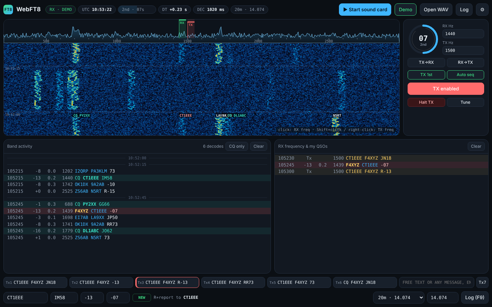

# WebFT8

**FT8 for HF amateur radio that runs in your browser — no install, any OS.**

WebFT8 decodes and transmits FT8 through your computer's sound card. It is a single self-contained HTML file: open it in Chrome or Edge, connect your rig's audio, set your call and grid, and start making QSOs. It is the sister project of [WebRTTY](https://loorisr.github.io/WebRTTY/).



---

## Features

**Receive**
- Waterfall + spectrum, synchronised to the 15-second UTC periods, with **callsigns drawn on the waterfall** at their frequency
- **Multi-pass decoder** in a Web Worker, off the main thread: Costas sync, fine time/frequency search, 1-, 2- and 3-symbol coherent bit metrics, LDPC belief propagation, **ordered-statistics decoding (OSD)**, and **signal subtraction** between passes so weak stations hidden under strong ones come out
- **A-priori (AP) decoding**, as in WSJT-X: messages that start with your call, with your call + the DX call, or with CQ are decoded a few dB lower. AP decodes are marked `a1`/`a2`/`a3`
- All standard FT8 message types: standard calls, `/P` and `/R`, grids, reports, RRR/RR73/73, `CQ DX` / `CQ 123`, non-standard calls (`PJ4/K1ABC`, type 4 with hash), free text, telemetry, DXpedition (Fox) messages
- Band activity and "RX frequency & my QSOs" panes; CQs in green, messages to you in red, already-worked calls struck through; **CQ only** filter
- SNR (2500 Hz) and DT for every decode; median **DT indicator** that warns when your clock is off, and one-click **clock correction** from the decodes

**Transmit**
- GFSK waveform identical to WSJT-X (BT = 2, raised-cosine ramps), started 0.5 s into your period
- **Click a decode** to call that station: the TX period, report and next message are chosen for you
- **Auto-sequencing** of the full QSO (Tx1 → Tx5) and **CQ mode** (Tx6): when several stations answer your CQ, the strongest is taken
- Six standard messages + free text (Tx7) with live check that the message can be encoded
- TX/RX frequencies set by clicking the waterfall; TX watchdog; **Tune** carrier; Esc halts TX
- **PTT** via VOX, or serial **RTS/DTR** (Web Serial). Both lines are released as soon as the port opens; PTT is released on page close or port loss

**Log**
- QSO logged automatically when RR73/RRR/73 is exchanged (or by hand with F9)
- Worked-before marking per band, **ADIF export** with grids, ready for your logbook program, LoTW tools or QRZ

**Other**
- **Demo mode**: a simulated band with background QSOs, fading and stations calling CQ. Call one of them — or call CQ yourself — and they answer, so you can try a whole QSO without a radio
- **Open WAV** to decode recordings (e.g. WSJT-X `.wav` saves, any sample rate)
- **Installable app (PWA)** that works offline after the first visit
- Interface in **English and French**; settings and log are kept in your browser

---

## Quick start

1. Open the app in **Chrome or Edge** (desktop), or download `index.html` and open it locally.
2. Press **Demo** to check it works, and click a green CQ line to try a QSO.
3. Open **⚙ Settings**: enter your **call** and **grid**; choose the **Input** (from rig) and **Output** (to rig) devices; choose a PTT method.
4. **Make sure your computer clock is correct** (within ±1 s of UTC; use NTP). The DT chip in the header tells you if it is not.
5. Put the rig in **USB** on an FT8 frequency (choose the band at the bottom right) and press **▶ Start sound card**.
6. Click a CQ to answer it, or select **Tx6** and press **Enable TX** to call CQ.

### Transmit tips
- FT8 transmits for 13 s out of every 30 s. Set the TX audio level so that the **ALC does not move**.
- Transmit on a clear frequency (Shift+click or right-click the waterfall) — you don't have to transmit on the frequency of the station you call.
- If your PTT is not serial RTS/DTR, use VOX or your interface's own PTT.

---

## Browser support

| Feature | Chrome / Edge | Firefox | Safari |
|---|---|---|---|
| Receive, waterfall, transmit | ✅ | ✅ | ✅ (mostly) |
| Output device selection | ✅ | ⚠️ partial | ❌ |
| Serial PTT (Web Serial) | ✅ | ❌ | ❌ |

Access to the sound card requires the page to be served over **HTTPS** (GitHub Pages is) or opened as a local file. Phones and tablets are not a target.

---

## Decoder performance

### Real recordings, against WSJT-X

The test set is the one shipped with [ft8_lib](https://github.com/kgoba/ft8_lib): **60 recordings** (15 s each, many from a busy 20 m band) with the messages **WSJT-X** decoded from each, **1289 in total**. Each decoder is scored on how many of those WSJT-X messages it finds.

| Decoder | WSJT-X messages found | Time per period* |
|---|---|---|
| **WebFT8, Deep** (default) | **1186 (92.0 %)** | 0.97 s |
| WebFT8, Normal | 1145 (88.8 %) | 0.72 s |
| WebFT8, Fast | 827 (64.2 %) | 0.27 s |
| ft8_lib (`decode_ft8`) | 932 (72.3 %) | — |

\* one core of a 2.1 GHz Xeon, in Node.js; Chrome runs the same code at the same speed in its worker.

WebFT8 Deep also decodes **61 messages that are not in the WSJT-X list**. For nearly all of them both callsigns appear elsewhere in the WSJT-X decodes, or the grid matches the callsign's country (e.g. `IU2KAJ JN45`, `VK2LAW QF56`), so they are real signals rather than false decodes. With CQ a-priori decoding on, 4 more WSJT-X messages and 9 more CQs are found, again all with consistent prefix and grid.

SNR estimates agree with WSJT-X within 0.2 dB on average (s.d. 4.6 dB); DT within 2 ms on average (s.d. 29 ms).

### Sensitivity in white noise

10 stations per period, random time offsets, SNR in 2500 Hz, 60 messages per point, the same files given to both decoders:

| SNR | WebFT8 | ft8_lib |
|---|---|---|
| −16 dB | **100 %** | 97 % |
| −18 dB | **100 %** | 73 % |
| −19 dB | **98 %** | 45 % |
| −20 dB | **68 %** | 10 % |
| −21 dB | **45 %** | 3 % |
| −22 dB | **7 %** | 0 % |

The 50 % point is about **−20.8 dB** (ft8_lib: −18.9 dB). WSJT-X is usually quoted at about −21 dB, so WebFT8 is close to it. These are simulated channels without fading; on-air comparisons are welcome — please open an issue with your results.

### Interoperability

The encoder was checked tone-for-tone against ft8_lib on standard, `/P`, `/R`, `CQ DX`, `CQ nnn`, report, `R` + grid, special-call (3DA0, 3X) and free-text messages. WAV files generated by WebFT8 decode in ft8_lib, including non-standard calls and hashes, and vice versa.

---

## How the decoder works

1. **Resampling** to 12 800 Hz (2048 samples per symbol), so every FFT is a power of two.
2. **Candidate search:** a spectrogram with ¼-symbol steps and 3.125 Hz bins; each frequency/time is scored by the power on the three 7×7 Costas arrays relative to the other tones (as WSJT-X `sync8`), normalised to the noise floor of the band. Up to 300 candidates per pass.
3. **Down-conversion:** one 262 144-point FFT of the whole period; for each candidate a 62.5 Hz slice is shifted to DC and brought back to a 200 Hz complex signal.
4. **Fine sync:** coherent correlation with the Costas tones over ±50 ms (5 ms steps) and ±3 Hz (0.25 Hz steps), then parabolic interpolation.
5. **Bit metrics:** 79 symbol spectra; log-likelihoods from 1-, 2- and 3-symbol coherent combinations (as WSJT-X), normalised.
6. **LDPC (174,91):** belief propagation (30 iterations) on each metric; if that fails on a good candidate, OSD order 1 (+ pairs among the least reliable bits in Deep mode), accepted only below a distance threshold. CRC-14 must match. OSD and AP results must also unpack to a valid message with real callsigns.
7. **Subtraction:** each decoded signal is regenerated (same GFSK as the transmitter), its complex amplitude tracked with a 0.3 s smoothing filter, and subtracted from the audio. Then the next pass runs on what is left (3 passes in Deep mode).
8. **A-priori:** for messages expected in your QSO, the known bits (your call, the DX call, CQ, message type) are fixed before decoding.

The DSP core (`ft8-core.js`) has no dependencies and also runs in Node.js:

```js
const FT8 = require('./ft8-core.js');
const results = FT8.decodeSlot(float32Samples, 12000, { depth: 3 });   // one 15 s period, any sample rate
// [{ freq, dt, snr, text: 'CQ K1ABC FN42', ... }]
const tones = FT8.textToTones('K1ABC W9XYZ R-09');                      // 79 tones
const wave = FT8.synth(tones, { sampleRate: 48000, f0: 1500, amplitude: 0.3 });
```

---

## Repository layout

```
index.html            the complete app (DSP core inlined) — this is what GitHub Pages serves
ft8-core.js           the DSP core on its own (message packing, LDPC, GFSK, decoder)
manifest.webmanifest  PWA manifest
sw.js                 service worker (offline support)
icon-192.png, icon-512.png
README.md
```

---

## Roadmap ideas

- CAT rig control (frequency readout, PTT over CAT)
- PSK Reporter spots
- Early decode at 11.8 s, like WSJT-X, for faster replies
- FT4
- Contest message types (Field Day, RTTY Roundup, EU VHF)

Contributions and on-air reports are welcome.

---

## Acknowledgements

FT8 was designed by **Joe Taylor, K1JT**, and **Steve Franke, K9AN**, and is implemented in [WSJT-X](https://wsjt.sourceforge.io/wsjtx.html), the reference for everything here. Thanks to **Kārlis Goba, YL3JG**, for [ft8_lib](https://github.com/kgoba/ft8_lib) (MIT), whose LDPC tables and test recordings were used to build and validate WebFT8.
